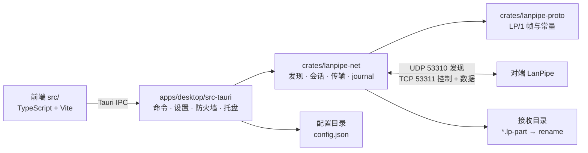

# LanPipe

[](LICENSE)
[](apps/desktop/src-tauri/tauri.conf.json)
[](#4-多端部署)
[](#10-开发)

LanPipe 是一款面向可信局域网的批量文件直传工具：把文件或目录拖入窗口、选择目标设备即可开始传输，接收端按文件边收边写，不做整包归档。

当前版本 `0.1.0`。Windows 桌面端是已验证的交付形态，Linux CLI 已在测试中验证；macOS 与 Linux 桌面端尚未验证。

## 1. 项目定位与适用场景

LanPipe 解决的是「两台设备之间搬运大量文件」这一类需求：不经过云端、不需要账号、不在接收端额外生成一份完整副本。发送端把文件流直接写进接收目录，每个文件完成后再落定。

| 适用场景 | 说明 |
| --- | --- |
| 局域网内迁移大型目录 | 游戏目录、素材库、工程备份等，单次数十 GB、数万文件 |
| 大批量小文件传输 | 接收端逐文件写入，不打包、不解包 |
| 隔离网络内部转运 | 数据不出内网，无外部依赖 |
| 接收端磁盘空间紧张 | 不需要为接收预留与源等量的镜像空间 |

> **安全边界（务必阅读）**
>
> LanPipe 仅推荐在**可信局域网**内使用。发现报文与文件数据都不经过云端或第三方中继；程序不面向公网暴露。
> 当前版本**没有加密，也没有身份认证**：同网段内任意运行 LanPipe 的实例都能发现设备并向其发送文件，接收端对发现到的发送方**自动接受**，不会弹出确认。
> 请勿在公共 Wi-Fi、访客网络、宿舍/办公共享网络或其他不受信任的网段运行。

明确的非目标：

- 不提供公网穿透、NAT 中继、账号体系与云同步；
- 不做持续双向同步（不是网盘客户端）；
- 只使用自有 LP/1 协议；不兼容第三方传输协议，也不与其互操作。

## 2. 核心特性

| 特性 | 说明 |
| --- | --- |
| 多流并行传输 | 1–8 条 TCP 数据流，默认 4；多个小文件按文件并发传输 |
| 零暂存接收 | 每个文件写入 `<文件名>.lp-part`，完成后 flush 并原子重命名 |
| 完整性校验 | 每个文件计算 xxHash64；校验失败按文件重传，最多 3 轮 |
| 断点续传（文件级） | 以 manifest 摘要为键记录 journal，重新发送同一目录时跳过已完成文件 |
| 自动发现 | UDP 53310 多播 `239.255.42.99` 与受限广播，2 秒一次，5 秒无心跳判离线 |
| 直连与短号 | 支持 `IP[:端口]` 直连，也支持 IPv4 末段短号（如 `5`、`005`）扫描定位 |
| 桌面体验 | 五页导航（发送/接收/历史/诊断/设置）、拖放、窄屏自适应；Mica/Acrylic 材质仅 Windows |
| 系统集成 | 托盘、开机自启、防火墙一键放行（UAC）、单实例 |
| 发行形态 | MSI 安装包（中文/英文）与便携 zip；自动更新骨架已接入（更新端点尚未部署） |

## 3. 快速开始

### 3.1 使用安装包（Windows，推荐）

双击 `LanPipe_0.1.0_x64_zh-CN.msi`（位于 `target\release\bundle\msi\`，或随发行包提供）按向导安装；静默安装（需要管理员权限）：

```powershell
msiexec /i "LanPipe_0.1.0_x64_zh-CN.msi" /qn
```

默认安装到 `C:\Program Files\LanPipe`，同时创建开始菜单快捷方式与卸载项。

### 3.2 使用便携版

解压 `LanPipe_0.1.0_x64-portable.zip`（位于 `target\release\bundle\portable\`），运行其中的 `LanPipe.exe`。配置写入 `%APPDATA%\LanPipe`；移除程序时退出托盘中的进程并删除解压目录即可，配置目录按需清理。

### 3.3 从源码构建（Windows）

前置条件：Windows 10/11 或同代 Windows Server（测试环境为 Server 2022）、Rust stable（MSVC 工具链）、Node.js 18 及以上、WebView2 Runtime（见 [docs/INSTALL.md](docs/INSTALL.md)）。

```powershell
npm install
npm run build
cargo build --release --features custom-protocol -p lanpipe
```

产物为 `target\release\lanpipe.exe`。也可以运行仓库根目录的 `build.bat`，按菜单提示完成构建，脚本会把可执行文件部署到 `%LOCALAPPDATA%\Programs\LanPipe\LanPipe.exe` 并复制到 `dist-bin\`。

发布构建必须带 `--features custom-protocol`；缺少该 feature 时程序会尝试加载开发服务器地址，表现为空白窗口。开发调试使用 `npm run dev` 配合 `cargo run -p lanpipe`（不带该 feature）。

### 3.4 完成第一次传输

1. 两台设备接入同一局域网，分别启动 LanPipe；接收端保持运行或最小化到托盘。
2. 发送端把文件或目录拖入窗口，在设备列表点击目标设备；也可以输入 IP 或尾号直连。
3. 接收端自动接受，文件写入默认目录 `%USERPROFILE%\Downloads\LanPipe\LanPipe-<Unix 秒>\`，可在设置中修改。
4. 传输结束后在「历史」查看结果；校验失败的文件会自动重传。

## 4. 多端部署

| 平台 | 形态 | 状态 | 入口 |
| --- | --- | --- | --- |
| Windows 10/11 | 桌面 GUI（MSI / 便携 zip） | 已验证（测试环境为 Server 2022） | 本文 §3 |
| Windows ARM64 | 交叉编译 | 构建脚本支持，运行未验证 | `build.bat` 交叉编译项 |
| Linux（WSL2 Ubuntu 24.04） | CLI | 已在测试中验证 | [docs/INSTALL.md](docs/INSTALL.md) §2.1 |
| Linux 桌面 | GUI（deb / AppImage） | 未验证 | [docs/INSTALL.md](docs/INSTALL.md) §2.2 |
| macOS | GUI（app / dmg） | 未验证 | [docs/INSTALL.md](docs/INSTALL.md) §3 |
| 移动端（Android / iOS） | — | 规划中 | M3 评估项 |

安装、源码构建、防火墙配置与常见问题的完整说明见 [docs/INSTALL.md](docs/INSTALL.md)。

## 5. 使用说明

### 5.1 发送

- **拖放 + 点击设备**：把文件或目录拖入发送页，设备列表会显示当前发现的在线设备，点击即发送。
- **IP 直连**：输入 `192.168.1.5` 或 `192.168.1.5:53311`；输入 1–3 位尾号（如 `5`、`005`）时，对本机各网卡所在网段做尾号扫描。
- **命令行**：`LanPipe.exe --send 192.168.1.5:53311 D:\Games --streams 4`。

传输中断后，再次向同一接收端发送同一目录即可续传：journal 记录已完成的文件，未完成文件的 `.lp-part` 会被清理后重传。续传目前为文件级，单个文件内部的偏移续传尚未实现。

### 5.2 接收

- 接收端自动接受连接并开始写入，没有确认弹窗；这是当前版本的设计取舍，也意味着同网段任意 LanPipe 实例都能向本机推送文件。
- 每次会话在接收目录下新建 `LanPipe-<Unix 秒>` 子目录，目录名由发送端在开始传输时生成，接收端按该名称落盘；续传时复用 journal 记录的目录名。
- 正在写入的文件带 `.lp-part` 后缀，完成后去除；中断残留的 `.lp-part` 在下次对同一目录续传时清理。

### 5.3 设置与诊断

| 设置项 | 默认值 |
| --- | --- |
| 接收目录 | `%USERPROFILE%\Downloads\LanPipe` |
| 设备名 | 主机名 |
| 设备 ID | 首次启动生成的 UUIDv4 |
| 监听端口 | UDP 53310 / TCP 53311 |
| 并发流 | 4（可调 1–8） |
| 压缩 | 关闭 |
| 托盘 | 常驻，关闭主窗口时收进托盘 |
| 开机自启 | 关闭，可手动启用 |

- 配置文件：`%APPDATA%\LanPipe\config.json`，写入采用原子替换；解析失败时备份为 `config.json.bad` 并回退默认值。
- 日志：GUI 为 `%TEMP%\LanPipe\lanpipe.log`，CLI 发送为 `%TEMP%\LanPipe\cli-send.log`。
- 诊断页显示配置路径、设备 ID、端口、WebView2 版本、连通性检查与透明回退状态。
- 单实例运行：关闭主窗口会收进托盘，从托盘菜单退出后进程才结束。

### 5.4 命令行接口

`lanpipe-cli` 用于无界面环境（Linux、WSL、脚本化测试）：

```text
lanpipe-cli recv --dest <目录> [--name 名称] [--id ID] [--udp 53310] [--tcp 53311]
lanpipe-cli send <ip:port> <路径>... [--streams N]
```

接收端启动后打印 `READY`、`PEER-UP`、`RECEIVED` 等事件行，便于脚本判断进度。

## 6. 架构概览



| 层 | 位置 | 职责 |
| --- | --- | --- |
| 前端 | `src/` | 视图与交互、状态管理、i18n、样式与材质 |
| 桌面外壳 | `apps/desktop/src-tauri/` | Tauri 命令与事件、设置读写、防火墙、托盘、单实例、更新检查 |
| 传输核心 | `crates/lanpipe-net/` | 设备发现、连接与会话、多流传输、校验重传、journal 续传 |
| 协议定义 | `crates/lanpipe-proto/` | LP/1 帧格式、端口与帧长常量 |
| 命令行 | `apps/cli/` | 无界面接收/发送 |

| 协议要点 | 值 |
| --- | --- |
| 发现 | UDP 53310，多播 `239.255.42.99` + 受限广播，2 s 间隔，5 s 无心跳判离线 |
| 控制与数据 | TCP 53311；N 条数据流（默认 4，可配 1–8） |
| 帧上限 | 数据帧 4 MiB，控制帧 64 MiB |
| 校验 | 每文件 xxHash64；失败文件重传，最多 3 轮 |
| 续传 | journal（JSONL）记录已完成文件，状态目录可配置 |
| 传输安全 | 明文，无加密、无认证（当前限制） |

端口均大于 1024，绑定不需要管理员权限；但 Windows 防火墙仍需放行入站规则，否则对端无法连接。

## 7. 性能实测

以下数字来自本机回环与虚拟机链路，**不代表真实物理网卡上限**。本机回环数据来自旧版 README 记录；跨机与 25 GB 用例的原始记录见 [docs/TEST-REPORT-2026-11-19.md](docs/TEST-REPORT-2026-11-19.md)。

### 7.1 本机回环（loopback）

数据集：903 个文件 / 63.9 MiB（900 个 1–8 KiB 小文件 + 3 个 20 MiB 大文件）。数据来自旧版 README 记录的本机回环测试。

| 并发流 | 耗时 | 吞吐 | 文件速率 |
| --- | --- | --- | --- |
| 1 | 3.26 s | 19.6 MiB/s | 277 文件/s |
| 2 | 1.76 s | 36.4 MiB/s | 514 文件/s |
| 4 | 1.30 s | 51.4 MiB/s | 693 文件/s |
| 8 | 1.27 s | 52.9 MiB/s | 715 文件/s |

纯大文件（3 × 20 MiB）：1 流 0.257 s（约 233 MiB/s），4 流 0.213 s（约 295 MiB/s）。接收端 903 个文件、66,956,746 字节与源完全一致，无残留。

### 7.2 Windows ↔ WSL2（虚拟链路）

测试环境：Windows Server 2022（Xeon E5-2680 v4 / 28 线程 / 64 GB，F: 为双 HDD 镜像卷，顺序写约 125 MiB/s）↔ WSL2 Ubuntu 24.04（NAT 网段 172.18.x），非真实千兆网卡。

| 用例 | 数据量 | 结果 |
| --- | --- | --- |
| host → WSL | 128 文件 / 91.6 MiB | 370–500 ms 完成 |
| WSL → host | 488 文件 / 510 MiB | 5.5–5.6 s，约 92.6 MiB/s（受 WSL 读取 `/mnt/f` 的 9p 带宽限制） |
| 25 GB 压测 | 43,594 文件 / 25,001,024,890 字节 | 22.3 分钟，约 18.7 MB/s（受源 HDD IOPS 限制） |

### 7.3 结论与局限

- 25 GB 用例逐文件清单一致，`.lp-part` 残留为 0，6,354 个 0 字节文件处理正确。
- 真实物理 1 GbE / 2.5 GbE 环境尚未实测（待验证）；AGENT.md §10 中「1GbE 混合目录 ≥100 MiB/s」仍未给出实测结论。
- 本机小文件吞吐低于 tar 管道基线（约 2,598 文件/s），小文件合批优化仍在计划中。
- 早期构建产物尺寸与当前源码版本不一致，不引用为性能指标。

## 8. 已知限制

### 8.1 安全与网络

- **无加密、无认证**：发现与传输均为明文；同网段任意 LanPipe 实例可发现设备并推送文件，接收端自动接受。仅可在可信局域网使用。
- **仅面向局域网**：不提供公网穿透、中继或 NAT 穿透能力；发现依赖 IPv4 多播/广播，跨网段需 IP 直连。
- 未实现发送前目标磁盘空间预检，空间不足时以单文件写入失败的形式暴露。

### 8.2 功能边界

- 断点续传为文件级（L1），单文件内部偏移续传（L2）未实现。
- 不逐文件 `fsync`：完成文件采用 flush + rename，掉电等强一致场景无保证。
- 压缩默认关闭；对已压缩内容（游戏、视频、素材）开启压缩无收益且增加 CPU 消耗。
- 「1 万小文件 ≥1800 文件/s」的验收指标尚未达成，当前本机实测约 700 文件/s。
- 单实例限制：已有实例运行时，第二次启动的 `--send` 参数会被忽略，需先从托盘退出。

### 8.3 平台与打包

- Windows 是唯一完成桌面验证的平台；macOS 与 Linux 桌面端未验证。
- WebView2 145.x / 154.x 存在窗口透明回归（上游 #5481、#5752），程序会自动回退纯色背景，诊断页显示 WebView2 版本与回退提示。
- NSIS 安装包静默安装（`/S`）返回 0 但不落盘，当前不作为交付形态（待查）；MSI 为主交付。
- 自动更新端点为占位 `https://example.invalid/lanpipe/latest.json`，检查更新必然失败；正式发布需替换端点并配置签名密钥。
- 目前只发布 x64 MSI 与便携 zip。

## 9. 文档索引

| 文档 | 内容 |
| --- | --- |
| `README.md` | 本文件：项目定位、核心特性、快速开始、实测摘要与安全边界 |
| [docs/INSTALL.md](docs/INSTALL.md) | Windows / Linux / macOS 安装、源码构建、防火墙配置、FAQ |
| [docs/PROTOCOL-LP1.md](docs/PROTOCOL-LP1.md) | LP/1 协议：发现、控制、数据帧、续传 journal（随代码同步） |
| [docs/UI-DESIGN.md](docs/UI-DESIGN.md) | 界面规范、布局与视觉基线 |
| [docs/TEST-REPORT-2026-11-19.md](docs/TEST-REPORT-2026-11-19.md) | 测试环境、用例与原始数据 |
| [docs/ui/](docs/ui/) | 线框图：发送、接收、设置、移动端 |
| [AGENT.md](AGENT.md) | 项目定位、硬约束、里程碑与开发约定（方向变更的唯一依据） |
| [CONTRIBUTING.md](CONTRIBUTING.md) | 分支模型、提交规范、合并前检查、发布流程 |
| [docs/TEAM.md](docs/TEAM.md) | 角色分工、交接清单、密钥与发布检查表 |
| [CHANGELOG.md](CHANGELOG.md) | 版本变更记录 |

## 10. 开发

### 10.1 环境要求

| 依赖 | 说明 |
| --- | --- |
| Rust | stable，版本由 `rust-toolchain.toml` 固定；含 rustfmt、clippy |
| Node.js | 18 及以上（Vite 6 要求） |
| C/C++ 工具链 | Windows 用 MSVC Build Tools；Linux 用 build-essential |
| 系统运行时 | Windows 需 WebView2 Runtime；Linux 桌面需 webkit2gtk 等依赖 |

### 10.2 常用命令

```powershell
npm install                 # 安装前端依赖
npm run build               # tsc --noEmit + vite build，产物在 dist/
cargo build --release --features custom-protocol -p lanpipe
cargo test                  # 工作区全部测试
cargo test -p lanpipe-net   # 协议与传输端到端测试
cargo clippy --workspace --all-targets -- -D warnings
build.bat package           # 打包 MSI + 便携 zip（含 SHA256 汇总）
build.bat test              # 代码门禁：cargo test + clippy
node tools/check-i18n.mjs   # 校验 i18n key 使用情况
```

前端必须先构建：`frontendDist` 指向 `dist/`，直接执行 cargo 构建会得到旧的或缺失的前端产物。

### 10.3 调试与本地验收

- 开发模式：`npm run dev` 启动 Vite，另开终端 `cargo run -p lanpipe`（不带 `custom-protocol`）。
- 同机双实例自测：`--instance b`，配置目录为 `%APPDATA%\LanPipe-b`；首次生成配置时 TCP 端口整体 +10，UDP 不变。
- 界面截图：以 `LANPIPE_CDP=9333` 启动应用，再运行 `node tools/ui-shot.mjs 9333 shot.png [navIndex]`（`navIndex` 0–4 对应发送、接收、历史、诊断、设置；`--tall` 截整页、`--mobile` 截 390×844）。
- 材质调试：`LANPIPE_BACKDROP=mica|acrylic|none`、`LANPIPE_TRANSPARENCY=force`。
- 一条命令打包：`build.bat package`（= `tools/package.ps1`，顺序：前端构建 → MSI → 便携 zip → 打印路径/大小/SHA256）。
- 打包并生成更新清单：`build.bat package publish`（需先设置 `LANPIPE_RELEASE_URL`，额外调用 `tools/publish-release.ps1` 生成 `latest.json`）。
- 单独打包：`powershell -NoProfile -ExecutionPolicy Bypass -File tools/package.ps1 -Bundles msi,portable`（`-SkipFrontend` 跳过前端构建；`-OutDir` 指定输出目录）。
- 首次打包会自动下载 WiX 到 `%LOCALAPPDATA%\tauri`；cargo 需在 PATH 中（`%USERPROFILE%\.cargo\bin`）。
- 发布：`tools/publish-release.ps1` 生成 `.sig` 与 `latest.json`，签名密钥由 `TAURI_SIGNING_PRIVATE_KEY` / `TAURI_SIGNING_PRIVATE_KEY_PASSWORD` 提供。

### 10.4 持续集成

- `.github/workflows/ci.yml`：push/PR 到 `main`、`dev` 时跑 i18n 检查、前端构建、`cargo test`、`clippy -D warnings` 与 release 构建。
- `.github/workflows/release.yml`：推送 `v*` tag 时构建 MSI、便携版、签名并生成 `latest.json`，创建 GitHub Release。

### 10.5 分支与提交

- 开发在 `dev` 分支进行，稳定版本合入 `main`；发布打标签，如 `v0.1.0-m2`。
- 提交信息用简洁祈使句说明改动范围与原因；涉及协议、架构或产品方向的改动，先更新 `AGENT.md`，再改代码。
- 提交前通过 `cargo fmt`、`cargo clippy -- -D warnings`、`cargo test` 与 i18n 校验。

### 10.6 代码约定

- 标识符用英文，注释与用户可见文案用中文；程序不包含遥测。
- 设置项集中在 `apps/desktop/src-tauri/src/settings.rs`，不散落在命令层。
- 文案统一走 `t()`，资源位于 `public/i18n/zh-CN.xml`；新增 key 后运行 `node tools/check-i18n.mjs`。
- 生产构建必须启用 `custom-protocol` feature。

## 11. 许可证

本项目使用 MIT 许可证，详见 [LICENSE](LICENSE)。

Copyright (c) 2026 LanPipe
