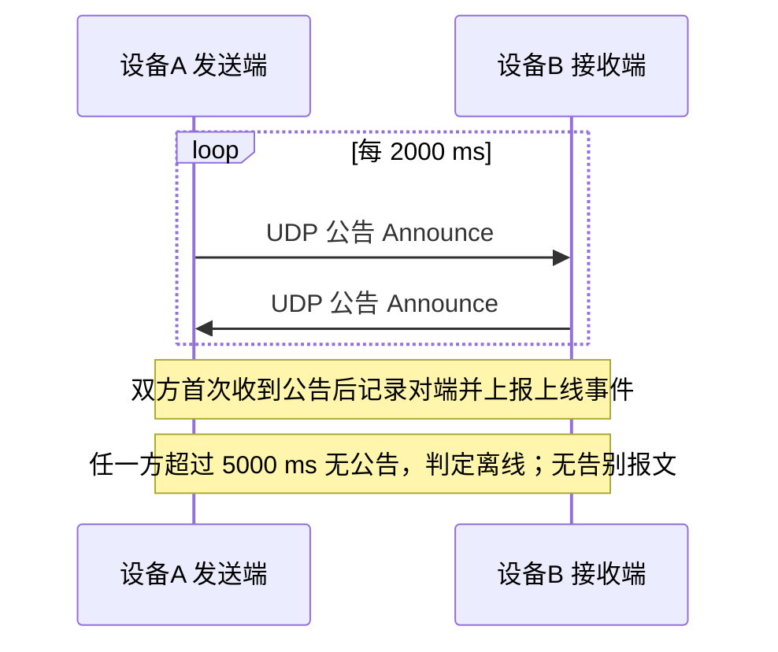
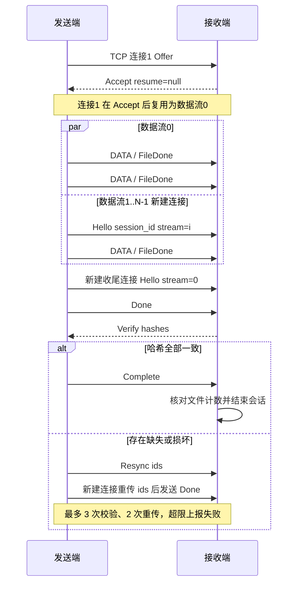
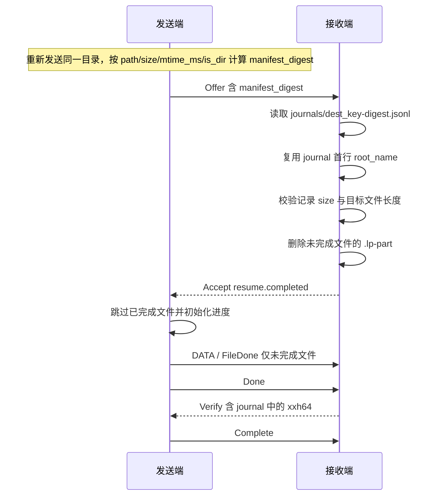

# LP/1 传输协议

| 项目 | 值 |
| --- | --- |
| 协议名称 | LP/1 |
| 线上版本 | `1`（`PROTOCOL_VERSION`，`crates/lanpipe-proto/src/lib.rs:9`） |
| 帧魔数 | `LPK1`（`crates/lanpipe-proto/src/lib.rs:10`） |
| 默认发现端口 | UDP `53310`（`crates/lanpipe-proto/src/lib.rs:12`） |
| 默认控制/数据端口 | TCP `53311`（`crates/lanpipe-proto/src/lib.rs:13`） |
| 帧头长度 | `12` 字节（`crates/lanpipe-proto/src/lib.rs:11`） |
| 控制帧上限 | `64 MiB`（`MAX_CONTROL_FRAME`，`crates/lanpipe-proto/src/lib.rs:17`） |
| DATA 帧上限 | `4 MiB`（`MAX_DATA_FRAME`，`crates/lanpipe-proto/src/lib.rs:15`） |
| DATA 分块大小 | `512 KiB`（`DATA_CHUNK`，`crates/lanpipe-proto/src/lib.rs:18`） |

本文档描述仓库当前代码实际实现的 LP/1 v1，供维护者与第三方实现参考。所有字段名、常量值与行为均以代码为准，文中给出对应位置。

---

## 1. 概览与设计目标

### 1.1 设计目标

LP/1 是 LanPipe 的局域网文件直传协议，面向“一次性发送大量文件或大文件”的场景，设计目标如下。

- **零暂存**：接收端不落完整归档再解包。文件内容边收边写入目标文件旁的 `.lp-part` 临时文件，接收完成后 `rename` 为最终文件（`crates/lanpipe-net/src/transfer.rs:134-194`、`196-266`）。接收端峰值额外磁盘占用约等于尚未改名的已接收数据，不随归档体积翻倍。
- **大批量清单**：一个 `Offer` 承载完整目录清单，控制帧上限 64 MiB，可容纳数万条目；哈希清单同样走控制帧。
- **多流并行**：单个会话使用 1–8 条 TCP 连接并行传文件，默认 4 条；文件级并行，不拆单文件。
- **完整性与纠错**：逐文件 xxHash64；`Done` 后接收端回报全部文件哈希，发送端比对后只重传不一致或缺失的文件。
- **文件级断点续传**：接收端用 journal 记录已完成文件与首次接收根目录名；发送端重新发送同一目录时按清单摘要命中 journal，跳过已完成文件。
- **可发现、可直连**：UDP 多播加广播自动发现；发现失效时可用 `IP:端口` 直连。
- **实现简单**：固定 12 字节帧头 + JSON 控制帧，便于单测与第三方实现。

### 1.2 非目标

以下能力不在 LP/1 v1 范围内。

- 公网传输、NAT 穿透、中继。
- 加密、身份认证、访问控制（当前为明文，见 §10）。
- 与任何第三方传输协议互操作。
- 单文件内部的字节偏移续传（`ResumeState.partial` 已预留结构，当前恒为空，见 §7.7）。
- 传输压缩（设置中存在 `compress` 字段，但传输引擎未实现压缩）。
- 保留源文件 `mtime`、权限位、符号链接等 POSIX 元数据（清单携带 `mtime_ms`，仅用于生成清单摘要）。

### 1.3 术语

| 术语 | 含义 |
| --- | --- |
| 发送端 | 发起 `Offer` 并发送文件的一方 |
| 接收端 | 监听 TCP 端口、接受 `Offer` 并落盘的一方 |
| 会话（session） | 一次发送任务，由发送端生成的 `session_id`（UUID v4 字符串）标识，贯穿该任务的全部连接 |
| 清单（manifest） | `Offer.entries`，目录树中每个文件/目录一项 |
| 数据流 | 承载 `DATA`/`FileDone` 帧的一条 TCP 连接，编号 0 到 N-1 |
| 摘要（manifest_digest） | 清单元数据的稳定 xxHash64 摘要，十六进制字符串，用于查找续传 journal |
| journal | 接收端本地的 JSONL 状态文件，记录已完成文件与接收根目录名 |
| `.lp-part` | 接收端写入中的临时文件后缀，完成后 `rename` 去掉该后缀 |

### 1.4 协议组成

| 层 | 承载 | 格式 | 作用 |
| --- | --- | --- | --- |
| 发现层 | UDP 53310 | JSON 公告（非 LP/1 帧） | 设备上下线 |
| 会话层 | TCP 53311 | LP/1 帧，JSON 载荷 | `Offer`/`Accept`/`Hello`/`Done`/`Verify`/`Resync`/`Complete`/`Reject`/`Error` |
| 数据层 | TCP 53311 | LP/1 帧，二进制载荷 | `DATA`/`FileDone` |
| 完整性 | 同上 | JSON | `Verify` 与 `Resync` |
| 续传状态 | 接收端本地文件 | JSONL | 不属于线上协议，仅接收端内部使用 |

---

## 2. 传输模型

### 2.1 端口与地址

| 常量 | 值 | 代码位置 |
| --- | --- | --- |
| `DEFAULT_UDP_PORT` | `53310` | `crates/lanpipe-proto/src/lib.rs:12` |
| `DEFAULT_TCP_PORT` | `53311` | `crates/lanpipe-proto/src/lib.rs:13` |
| `MULTICAST_GROUP` | `239.255.42.99` | `crates/lanpipe-proto/src/lib.rs:14` |
| `ANNOUNCE_INTERVAL_MS` | `2000` | `crates/lanpipe-net/src/discovery.rs:15` |
| `PEER_TIMEOUT_MS` | `5000` | `crates/lanpipe-net/src/discovery.rs:16` |

UDP 端口与 TCP 端口均可在设置中修改（`apps/desktop/src-tauri/src/settings.rs:58-69`），默认值如上。桌面端同机多实例通过 `--instance` 偏移端口，仅 TCP 偏移、UDP 保持 53310（`apps/desktop/src-tauri/src/main.rs:94-105`）。发现公告中的 `port` 字段通告的是对端的 TCP 控制端口。

### 2.2 连接拓扑

一次完整传输使用的 TCP 连接如下。

| 连接 | 数量 | 首帧 | 用途 |
| --- | --- | --- | --- |
| 控制连接 | 1 | `Offer` | 携带清单并接收 `Accept`/`Reject`；`Accept` 之后**复用为数据流 0** |
| 数据连接 | N-1 | `Hello` | 数据流 1 到 N-1 |
| 收尾连接 | 1 | `Hello` | 发送 `Done` 并接收 `Verify`，随后按需发送 `Resync`/`Complete` |

N 为流数，范围 1–8，默认 4（`crates/lanpipe-net/src/transfer.rs:891`、`apps/desktop/src-tauri/src/settings.rs:90`、`:244`）。因此传输阶段连接数为 N（控制连接充当流 0），收尾阶段额外建立 1 条。

接收端只有一个 TCP 监听器，按每条连接的首帧区分 `Offer` 与 `Hello`（`crates/lanpipe-net/src/transfer.rs:497-667`）。同一 `session_id` 的所有连接共享同一份接收会话状态（`crates/lanpipe-net/src/transfer.rs:623`、`646`）。

### 2.3 会话生命周期

1. 发送端生成 `session_id`，在控制连接上发送 `Offer`。
2. 接收端校验版本与路径、查 journal、创建会话对象，回复 `Accept`（或 `Reject`）。
3. 发送端建立其余数据连接，各流从共享队列领取文件并发送 `DATA` 与 `FileDone`。
4. 数据发完后，发送端另建连接，发送 `Hello` 关联会话，再发送 `Done`。
5. 接收端回复 `Verify`；发送端比对后回复 `Complete`，或回复 `Resync` 触发按文件重传，然后进入下一轮 `Done`。
6. 接收端收到 `Complete` 后核对文件计数，移除会话（`crates/lanpipe-net/src/transfer.rs:737-752`）。

会话表保存在接收端进程内存中，进程退出即丢失；跨进程的续传状态由 journal 承担（§7）。接收端未收到 `Complete` 前不会主动过期会话，只在校验轮次超限时移除（`crates/lanpipe-net/src/transfer.rs:753-760`）。

### 2.4 发现与直连

UDP 发现是可选的：接收端在已知 `IP:端口` 时也可直接接受 `Offer`。发送端若输入的目标不含端口，使用本机配置的 TCP 端口（`apps/desktop/src-tauri/src/net.rs:396-400`）。尾号扫描（输入 `5` 扫描各网段 `*.5:53311`）属于桌面端交互便利功能，不属于协议。

---

## 3. 帧格式

### 3.1 帧头

所有 LP/1 帧以 12 字节固定头开始，随后是 `len` 字节载荷（`crates/lanpipe-proto/src/lib.rs:143-174`）。

| 偏移 | 长度 | 字段 | 编码 | 说明 |
| --- | --- | --- | --- | --- |
| 0 | 4 | `magic` | ASCII | 固定 `LPK1`（`0x4C 0x50 0x4B 0x31`） |
| 4 | 1 | `type` | u8 | 帧类型，见 §4.0 |
| 5 | 1 | `flags` | u8 | 当前实现未定义语义，接收端忽略 |
| 6 | 2 | `stream` | u16，大端 | 数据流编号；控制类帧为 0 |
| 8 | 4 | `len` | u32，大端 | 载荷字节数（不含帧头） |
| 12 | `len` | `payload` | 见 §3.2、§3.3 | 载荷 |

所有多字节整数均为大端（`crates/lanpipe-proto/src/lib.rs:4`、`:144-152`）。`read_frame` 先读满 12 字节头，校验 magic 与类型，再检查 `len` 是否超过调用方给定的上限，最后读载荷（`crates/lanpipe-proto/src/lib.rs:193-216`）。对端正常关闭连接时 `read_frame` 返回 `None`，而不是错误。

> 实现备注：`crates/lanpipe-proto/src/lib.rs:3` 的模块注释把第 6–7 字节写作 `reserved(2)`，但 `encode_header` 实际写入的是 `stream: u16`，接收端也按 `stream` 解码（`crates/lanpipe-proto/src/lib.rs:149`、`:170`）。文档以代码行为为准。

### 3.2 控制帧载荷

控制帧载荷是 UTF-8 编码的 JSON 对象，无 BOM，字段名为 snake_case，字段顺序不作要求。serde 默认忽略未知字段，因此新增可选字段不会破坏旧实现（§11.2）。

注意：`Verify`/`Resync` 中的哈希与 id 使用 JSON 数字表示 `u64`/`u32`。`u64` 哈希可能超过 2^53，第三方实现必须用 64 位整数解析，不能依赖双精度浮点。

### 3.3 DATA 帧载荷

`DATA` 帧载荷为二进制，前缀固定 12 字节（`crates/lanpipe-net/src/transfer.rs:684-689`）。

| 偏移 | 长度 | 字段 | 编码 | 说明 |
| --- | --- | --- | --- | --- |
| 0 | 4 | `id` | u32，大端 | 文件在清单中的 `id` |
| 4 | 8 | `offset` | u64，大端 | 本块在文件内的字节偏移 |
| 12 | n | `data` | 原始字节 | 文件内容，长度 `len - 12` |

约束：

- 载荷总长必须 `>= 12`，否则接收端断开该连接（`crates/lanpipe-net/src/transfer.rs:678-680`）。
- 载荷总长必须 `<= MAX_DATA_FRAME`（4 MiB），否则断开连接（`crates/lanpipe-net/src/transfer.rs:681-683`）。
- 当前发送端固定按 `DATA_CHUNK = 512 KiB` 读取并发送（`crates/lanpipe-net/src/transfer.rs:1160`、`:1171-1175`）；4 MiB 是协议上限，不是实际分块大小。
- `offset` 必须等于接收端该文件已写字节数，否则接收端报错并结束该连接（`crates/lanpipe-net/src/transfer.rs:178-180`）。

### 3.4 读取上限

接收端和发送端读取帧时统一使用 `MAX_CONTROL_FRAME`（64 MiB）作为 `read_frame` 的 `max_len`（`crates/lanpipe-net/src/transfer.rs:490`、`:670`、`:1021`）。这意味着：

- 控制帧载荷上限为 64 MiB。
- 恶意或异常的对端可声明最大 64 MiB 的 `DATA` 帧长度；接收端会先读入再按 4 MiB 上限拒绝并断开连接。实现者在分配内存前应先做类型相关校验。

### 3.5 `flags` 与 `stream` 语义

- 发送端在 `DATA` 与 `FileDone` 帧中把 `flags` 与 `stream` 都写成数据流编号（`crates/lanpipe-net/src/transfer.rs:1181-1182`、`:1200-1201`）；`Hello` 帧 `flags = 0`、`stream = 流编号`（`crates/lanpipe-net/src/transfer.rs:1145-1147`）。
- 控制类帧（`Offer`/`Accept`/`Reject`/`Done`/`Verify`/`Resync`/`Complete`/`Error`）的 `flags` 与 `stream` 均为 0。
- 接收端不校验这两个字段（读取时直接忽略），仅用于抓包与日志定位。第三方实现应容忍任意值，尤其不要把 `stream` 当作顺序保证。

---

## 4. 帧类型与消息语义

### 4.0 类型总表

| 值 | 名称 | 方向 | 载荷 | 作用 |
| --- | --- | --- | --- | --- |
| 1 | `Hello` | 发送端 → 接收端 | JSON | 把新建连接绑定到已有会话 |
| 2 | `Offer` | 发送端 → 接收端 | JSON | 清单与续传摘要，控制连接首帧 |
| 3 | `Accept` | 接收端 → 发送端 | JSON | 接受会话，可携带可复用进度 |
| 4 | `Reject` | 接收端 → 发送端 | JSON | 拒绝会话（版本不符、非法路径） |
| 5 | `DATA` | 发送端 → 接收端 | 二进制 | 文件数据块 |
| 6 | `FileDone` | 发送端 → 接收端 | JSON | 单个文件发送完毕 |
| 7 | `Done` | 发送端 → 接收端 | 空 | 本轮数据发送完毕，请求校验 |
| 8 | `Error` | 双向 | JSON | 协议层错误 |
| 9 | `Verify` | 接收端 → 发送端 | JSON | 逐文件哈希清单 |
| 10 | `Resync` | 发送端 → 接收端 | JSON | 要求重传的文件 id 列表 |
| 11 | `Complete` | 发送端 → 接收端 | 空 | 校验通过，会话成功 |

枚举与数值映射见 `crates/lanpipe-proto/src/lib.rs:20-56`。未知类型无法解码，按协议错误处理。

### 4.1 发现公告（UDP，非 LP/1 帧）

发现层使用独立的 UDP JSON 报文，不走 LP/1 帧头（`crates/lanpipe-net/src/discovery.rs:31-39`）。

| 字段 | 类型 | 说明 |
| --- | --- | --- |
| `addrs` | `string[]` | 发送方所有非回环 IPv4 地址，字符串形式；无可用网卡时为空 |
| `v` | u8 | 公告版本，当前固定 `1`；接收端不校验 |
| `id` | string | 设备 ID（UUID 字符串），用于去重与过滤自身公告 |
| `name` | string | 设备显示名 |
| `port` | u16 | 对端 TCP 控制端口 |

示例：

```json
{
  "addrs": ["192.168.1.23", "172.18.240.1"],
  "v": 1,
  "id": "3b0f6c2e-8a41-4d2f-9c77-58a1e0d4b912",
  "name": "DESKTOP-7K2",
  "port": 53311
}
```

行为约定：

- 每 2000 ms 公告一次（`crates/lanpipe-net/src/discovery.rs:15`、`:133`）。
- 每块非回环网卡单独建发送 socket，并把多播出口固定到该网卡；目标是多播组 `239.255.42.99:53310`、该网卡子网定向广播、受限广播 `255.255.255.255:53310`（`crates/lanpipe-net/src/discovery.rs:233-276`）。
- 接收端绑定 `0.0.0.0:53310`，在默认接口与每块非回环网卡上加入多播组（`crates/lanpipe-net/src/discovery.rs:69-95`）。
- 收到公告后按 `id` 去重；`id` 等于本机则忽略（`crates/lanpipe-net/src/discovery.rs:152-154`）。首次见到某设备才产生上线事件，后续公告只刷新时间戳（`crates/lanpipe-net/src/discovery.rs:161-167`）。
- 超过 5000 ms 未收到公告判定离线，清扫任务每 1000 ms 执行一次（`crates/lanpipe-net/src/discovery.rs:171-194`）。
- 没有下线告别报文，离线完全依赖超时。
- 对端连接地址优先取与“默认路由出口网卡”同 /24 的公告地址，其次取与任一本地网卡同 /24 的地址，最后退回 UDP 包的源地址（`crates/lanpipe-net/src/discovery.rs:290-314`）。

### 4.2 `Hello`

把一条新 TCP 连接绑定到已存在的会话（`crates/lanpipe-proto/src/lib.rs:108-112`）。

| 字段 | 类型 | 说明 |
| --- | --- | --- |
| `session_id` | string | 会话 ID |
| `stream` | u16 | 数据流编号，发送端填当前流索引 |

示例：

```json
{"session_id": "6f1c0e9a-3d2b-4f7e-9a51-2c8b7d4e1f30", "stream": 1}
```

接收端行为：

- 会话存在：连接继续用于该会话。
- 会话不存在：回复 `Error {"message":"会话不存在或已结束"}` 并关闭连接（`crates/lanpipe-net/src/transfer.rs:643-658`）。
- `Hello` 只能作为连接首帧；连接建立后不再出现。

### 4.3 `Offer`

控制连接首帧，携带完整清单与续传摘要（`crates/lanpipe-proto/src/lib.rs:69-79`）。

| 字段 | 类型 | 说明 |
| --- | --- | --- |
| `version` | u8 | 协议版本，必须等于 `1`，否则接收端回 `Reject`（`crates/lanpipe-net/src/transfer.rs:501-508`） |
| `session_id` | string | 本次会话 ID，UUID v4 |
| `root_name` | string | 建议的接收根目录名；发送端默认生成 `LanPipe-<Unix 秒>`（`crates/lanpipe-net/src/transfer.rs:871`）。接收端若命中 journal 会改用 journal 中记录的根名 |
| `entries` | `ManifestEntry[]` | 目录树清单，见下表 |
| `total_bytes` | u64 | 所有文件大小之和；接收端会按清单重新计算，不信任此字段 |
| `manifest_digest` | string | 清单摘要，16 位小写十六进制；缺省或空字符串表示不启用续传（`#[serde(default)]`） |

`ManifestEntry`（`crates/lanpipe-proto/src/lib.rs:59-67`）：

| 字段 | 类型 | 说明 |
| --- | --- | --- |
| `id` | u32 | 清单内唯一编号，从 0 单调递增分配；目录项同样占用 `id`，因此文件 id 可能不连续 |
| `path` | string | 相对接收根目录的路径，统一用 `/` 分隔；禁止绝对路径与 `..` |
| `size` | u64 | 文件字节数；目录项为 0 |
| `mtime_ms` | u64 | 源文件 mtime，Unix 毫秒；取不到时为 0 |
| `is_dir` | bool | 目录标志，缺省 `false`（`#[serde(default)]`） |

清单生成规则（`crates/lanpipe-net/src/transfer.rs:801-873`）：

- 顶层重名时追加序号：第二个同名项为 `name(2)`，第三个为 `name(3)`。
- 目录递归时 `path` 形如 `<顶层名>/<相对路径>`，反斜杠替换为 `/`，不跟随符号链接。
- 单文件发送时其 `path` 就是文件名本身，没有额外的根目录层。
- 目录项 `size = 0` 且 `is_dir = true`；`total_bytes` 只累计文件大小。
- 只发送目录（没有任何文件）会被发送端拒绝（“没有可发送的文件”）。

示例（截断）：

```json
{
  "version": 1,
  "session_id": "6f1c0e9a-3d2b-4f7e-9a51-2c8b7d4e1f30",
  "root_name": "LanPipe-1763836800",
  "entries": [
    {"id": 0, "path": "Games", "size": 0, "mtime_ms": 1763836123456, "is_dir": true},
    {"id": 1, "path": "Games/a.bin", "size": 1048576, "mtime_ms": 1763836123456, "is_dir": false},
    {"id": 2, "path": "Games/sub", "size": 0, "mtime_ms": 1763836123456, "is_dir": true},
    {"id": 3, "path": "Games/sub/empty.txt", "size": 0, "mtime_ms": 1763836123456, "is_dir": false}
  ],
  "total_bytes": 1048576,
  "manifest_digest": "9f2c4a1b7d3e5f60"
}
```

接收端行为（`crates/lanpipe-net/src/transfer.rs:498-641`）：

1. 校验 `version`。
2. 对每个条目校验路径；非法路径回 `Reject {"reason":"非法路径: ..."}`（`:529-536`）。非法路径包括空串、绝对路径和任何非普通组件（`.`、`..`、盘符前缀）。
3. 重复 `id` 不回复 `Reject`，而是直接以连接错误结束（`:540-542`）；该检查只覆盖文件项，目录项不参与。实现者应注意这一差异（§10.5）。
4. 目录项只记账，不在 `Accept` 前创建；`Accept` 之后由后台任务创建（`:525-527`、`:633-640`），文件写入时也会按需创建父目录（`:149-153`）。
5. 若 `manifest_digest` 非空，加载 journal 并计算可跳过文件（§7）。
6. 回复 `Accept`，随后控制连接转为数据流 0。

### 4.4 `Accept`

| 字段 | 类型 | 说明 |
| --- | --- | --- |
| `session_id` | string | 会话 ID，与 `Offer` 一致 |
| `resume` | object 或 null | 缺省/null 表示全量发送；非空时给出可跳过文件（`#[serde(default)]`） |

`ResumeState`（`crates/lanpipe-proto/src/lib.rs:82-87`）：

| 字段 | 类型 | 说明 |
| --- | --- | --- |
| `completed` | `u32[]` | 接收端已有且大小匹配的已完成文件 id，已排序 |
| `partial` | `{id, offset}[]` | 预留的块级进度，当前实现恒为空数组（L2 扩展） |

全量接收示例：

```json
{"session_id": "6f1c0e9a-3d2b-4f7e-9a51-2c8b7d4e1f30", "resume": null}
```

续传示例：

```json
{"session_id": "6f1c0e9a-3d2b-4f7e-9a51-2c8b7d4e1f30", "resume": {"completed": [1, 4, 7], "partial": []}}
```

发送端只读取 `resume.completed`；`partial` 当前被忽略（`crates/lanpipe-net/src/transfer.rs:937-947`）。`Accept` 帧类型匹配但 JSON 解析失败时，发送端按“无可复用进度”全量发送（`:937`）。

### 4.5 `Reject`

| 字段 | 类型 | 说明 |
| --- | --- | --- |
| `reason` | string | 人类可读拒绝原因 |

当前触发条件：协议版本不匹配、清单中存在非法路径。示例：

```json
{"reason": "协议版本不匹配: 2"}
```

发送端收到 `Reject` 后向 UI 发送失败事件并结束本次任务（`crates/lanpipe-net/src/transfer.rs:923-932`）。

### 4.6 `DATA`

见 §3.3。发送端按文件顺序读取 512 KiB 块，块内偏移从 0 递增；同一文件的所有 `DATA` 帧走同一条数据流。

### 4.7 `FileDone`

| 字段 | 类型 | 说明 |
| --- | --- | --- |
| `id` | u32 | 文件 id |

示例：`{"id": 1}`。

接收端处理（`crates/lanpipe-net/src/transfer.rs:691-694`、`:196-266`）：

- 取出该文件的 `.lp-part`，`flush`，校验累计字节数是否等于清单 `size`。
- 大小不符：删除 `.lp-part` 并返回错误（该连接结束）。
- 大小一致：原子 `rename` 为最终文件，把流式计算的 xxh64 记入会话哈希表与 journal，文件计数加一。
- 重复的 `FileDone`（同一 id 已完成）幂等返回，不重复计数。
- 0 字节文件不会产生 `DATA`，但仍会收到 `FileDone`；接收端走 `finish_empty_file` 创建空文件、计算空文件哈希并计数（`crates/lanpipe-net/src/transfer.rs:268-305`）。
- 不执行逐文件 `fsync`，只保证写完并 `rename`（`crates/lanpipe-net/src/transfer.rs:227-229`）。

### 4.8 `Done`

空载荷。发送端在全部数据流结束后，另建连接发送 `Hello` 再发 `Done`（`crates/lanpipe-net/src/transfer.rs:1001-1019`）。

接收端处理（`crates/lanpipe-net/src/transfer.rs:695-762`）：

1. 最多等待 1 秒（20 × 50 ms）让跨连接的 `FileDone` 追平文件计数；等不到也继续。
2. 发送 `Verify`，载荷为当前会话哈希表的完整快照。
3. 循环等待发送端决定：`Resync` 表示按文件重传，`Done` 表示进入下一轮校验，`Complete` 表示通过。
4. 收到 `Complete` 后核对文件计数，相等则发出接收完成事件并移除会话；不等则上报失败。
5. 校验轮次达到 5 仍不通过则上报失败并移除会话。

### 4.9 `Verify`

接收端 → 发送端，逐文件哈希清单（`crates/lanpipe-proto/src/lib.rs:119-130`）。

| 字段 | 类型 | 说明 |
| --- | --- | --- |
| `hashes` | `FileHash[]` | 每个已完成文件一项 |

`FileHash`：

| 字段 | 类型 | 说明 |
| --- | --- | --- |
| `id` | u32 | 文件 id |
| `hash` | u64 | xxHash64（seed 0），发送与接收端对实际传输字节流式计算 |

示例：

```json
{"hashes": [{"id": 1, "hash": 12345678901234567890}, {"id": 3, "hash": 17241709254077376921}]}
```

续传跳过的文件也会出现在 `Verify` 中，哈希值来自 journal 记录（§7.6）。

> **时序要求**：`Done` 走独立连接，接收端发出 `Verify` 前必须确认所有数据连接上的 `DATA`/`FileDone` 已处理完（`files_done == total_files`）。否则清单会缺少在途文件，发送端按缺失重传，与旧帧并发写同一个文件，造成偏移冲突与 rename 竞争。发送端只在全部数据流成功后发送 `Done`，因此该等待不会死锁；接收端保留超时兜底。

### 4.10 `Resync`

发送端 → 接收端，要求重传的文件 id（`crates/lanpipe-proto/src/lib.rs:132-136`）。

| 字段 | 类型 | 说明 |
| --- | --- | --- |
| `ids` | `u32[]` | 需要重传的文件 id |

示例：`{"ids": [1, 5]}`。

接收端处理（`crates/lanpipe-net/src/transfer.rs:322-351`、`:721-725`）：

- 删除这些 id 已落地的最终文件与可能残留的 `.lp-part`。
- 从会话哈希表移除对应哈希。
- 若该文件已计入完成数（有哈希或有落地文件），回退文件计数与字节计数。
- 收到 `Resync` 后不重新发送 `Verify`，继续等待发送端下一帧（实际发送端会开始重传，随后再发 `Done`）。

### 4.11 `Complete`

空载荷。发送端在校验通过时发送（`crates/lanpipe-net/src/transfer.rs:1049-1053`）。接收端收到后：

- 文件计数等于清单文件总数：发出接收完成事件，移除会话（`:737-750`）。
- 计数不等：上报失败“校验通过但文件数不符”，移除会话。

### 4.12 `Error`

| 字段 | 类型 | 说明 |
| --- | --- | --- |
| `message` | string | 错误描述 |

示例：`{"message":"需要 Offer 或 Hello 作为首帧"}`。

出现场景（`crates/lanpipe-net/src/transfer.rs:650-666`、`:763-768`、`:728-733`、`:1091-1096`）：

- 连接首帧不是 `Offer` 或 `Hello`。
- `Hello` 指向不存在的会话。
- 校验阶段收到对端 `Error`。
- 发送端读取 `Accept` 恢复状态时遇到 `Error`（按非预期响应处理）。

### 4.13 名称对照

早期草案或任务书中使用的名称与当前实现对应如下。

| 草案名称 | 当前实现 |
| --- | --- |
| `Discover` | 无对应帧；发现是独立的 UDP JSON 公告（§4.1） |
| `FileHeader` | `Offer.entries` 中的 `ManifestEntry`，无逐文件独立帧 |
| `FileData` | `DATA` 帧 |
| `FileEnd` | `FileDone` |
| `Failed` | 线上为 `Error` 帧；`TransferEvent::Failed` 只是本地 UI 事件 |
| `Accept 180s` | 实现为 900 秒等待上限（§9） |

---

## 5. 数据流调度

### 5.1 文件到流的分配

发送端把待发送文件放进共享队列（`VecDeque`），N 条数据流各自循环“取队首文件 → 完整发送 → 取下一个”（`crates/lanpipe-net/src/transfer.rs:1122`、`:1151-1208`）。

- 分配方式是**工作窃取式共享队列**，不是按文件大小分配，也不是固定 round-robin。
- 一个文件只由一条流发送，不拆分到多条流；大文件会独占该流直到发完，可能造成队首阻塞。
- 队列初始顺序来自清单顺序（即遍历顺序）；先取先发，不保证接收端最终文件的网络到达顺序。

### 5.2 连接建立顺序

1. 发送端连接接收端，发送 `Offer`，等待 `Accept`。
2. `Accept` 后，原控制连接直接作为数据流 0，不再发送 `Hello`。
3. 发送端再建立 `streams - 1` 条连接；每条首帧为 `Hello{session_id, stream: 当前流索引}`。
4. 全部数据流结束后，发送端建立收尾连接，发送 `Hello{session_id, stream: 0}`，再发送 `Done`。
5. 校验失败重传时，发送端为这批文件重新建立 `streams` 条连接，全部先发 `Hello`（重传轮次不再复用旧控制连接），发送完 `FileDone` 后再在同一收尾连接上发送下一轮 `Done`（`crates/lanpipe-net/src/transfer.rs:1076-1089`）。

### 5.3 背压与顺序

- 发送端每条流一次只读一个 512 KiB 块，写完再读下一块；`write_frame` 包含 `flush`，并带 900 秒超时（`crates/lanpipe-net/src/transfer.rs:1160-1188`）。
- 接收端对单个文件的写入由该文件独有的异步锁串行化；不同文件可并行写入（`crates/lanpipe-net/src/transfer.rs:177-188`、`:102`）。
- 接收端不设置应用层窗口；背压由 TCP 发送缓冲与接收端磁盘写入速度自然形成。
- 同一文件内 `offset` 必须严格递增且连续；跨文件、跨流没有全局顺序要求。

### 5.4 目录与零字节文件

- 目录不产生任何数据帧。接收端在 `Accept` 后启动后台任务逐条 `create_dir_all`（`crates/lanpipe-net/src/transfer.rs:633-640`），文件写入时也会按需创建父目录。因此空目录也会被还原。
- 零字节文件不产生 `DATA` 帧，由 `FileDone` 触发空文件创建（§4.7）。

---

## 6. 完整性与纠错

### 6.1 逐文件哈希

- 算法：xxHash64，seed = 0（`xxhash_rust::xxh64`）。
- 发送端边读边算，只统计实际发送的字节（`crates/lanpipe-net/src/transfer.rs:1162`、`:1171`、`:1192-1195`）。
- 接收端边写边算，只统计写入 `.lp-part` 的字节（`crates/lanpipe-net/src/transfer.rs:186`）。
- 0 字节文件哈希为空输入的 xxh64 值（`crates/lanpipe-net/src/transfer.rs:286`）。
- 重传时发送端重新计算并覆盖该文件的本地哈希。

### 6.2 `Verify` 的比对规则

发送端收到 `Verify` 后（`crates/lanpipe-net/src/transfer.rs:1029-1048`）：

1. 对 `Verify.hashes` 中每一项：本地有同 id 哈希且相等则通过；本地没有该 id 且该 id 属于续传跳过集合则信任接收端 journal；否则加入重传列表。
2. 再遍历本地哈希表，凡是接收端没有上报的 id 也加入重传列表。
3. 重传列表为空则发送 `Complete`；否则发送 `Resync`。

因此 `Verify` 是最终权威：跨连接竞态导致 `Done` 到达时个别 `FileDone` 未处理的情况，会因“本地有、接收端未上报”而被修复。

### 6.3 重传流程

接收端收到 `Resync` 后删除对应最终文件与 `.lp-part` 并回退计数（§4.10）；发送端用新连接重传这些文件，然后再次 `Done`。循环上限：

| 侧 | 上限 | 行为 |
| --- | --- | --- |
| 发送端 | 最多 3 次校验、2 次重传（`attempt >= 3` 时报错） | 上报“校验未通过：重传 2 次后仍有 N 个文件不一致”（`crates/lanpipe-net/src/transfer.rs:1055-1066`） |
| 接收端 | 5 轮（`round >= 5` 时报错） | 上报“校验重传次数超限”（`crates/lanpipe-net/src/transfer.rs:753-760`） |

实际有效上限由发送端的 3 轮决定。

### 6.4 测试钩子

环境变量 `LANPIPE_FAULT_DROP_HASH=1` 时，接收端会把首个完成文件的哈希异或 `0xA5A5A5A5A5A5A5A5` 后上报，用于强制触发 `Verify → Resync → 重传` 链路；文件本身仍正常落盘并计数（`crates/lanpipe-net/src/transfer.rs:240-248`）。

### 6.5 未覆盖的校验范围

- 帧头与 JSON 载荷没有 CRC 或消息认证码；`flags` 字段当前未用于校验。
- `DATA` 块没有独立校验，损坏只能在 `Done` 后的整文件哈希比对中发现。
- `manifest_digest` 只用于查找 journal，不用于证明清单内容完整。
- 接收端不校验 `Offer.total_bytes`，也不校验清单声明的总大小与磁盘剩余空间。

### 6.6 UI 事件与协议终态

接收端在文件计数达到总数的瞬间就会发出“接收完成”事件，而协议层终态是 `Complete`（`crates/lanpipe-net/src/transfer.rs:262-264`、`:353-367`）。若随后校验失败并进入重传，UI 可能先看到完成、再看到失败；协议实现应以 `Complete` 为成功判据，不应依赖本地事件顺序。

---

## 7. 断点续传

### 7.1 `manifest_digest` 计算

发送端在发送 `Offer` 前对所有清单条目（含目录项）计算摘要（`crates/lanpipe-net/src/journal.rs:15-30`）：

```
1. 将 entries 按 path 的字节序升序排序；
2. 对每个条目依次追加到缓冲区：
     path 的 UTF-8 字节 + 0x00
     size 的 8 字节大端 + 0x00
     mtime_ms 的 8 字节大端 + 0x00
     is_dir（0 或 1）+ 0x0A
3. 对缓冲区做 xxHash64（seed = 0），输出 16 位小写十六进制字符串。
```

特征与约束：

- `id` 与 `root_name` 不参与摘要，因此同一目录树换一次发送、id 重新分配不影响命中。
- `mtime_ms` 参与摘要：源文件被触碰、复制导致 mtime 变化，摘要即不同，续传不会命中。
- 目录项也参与摘要，目录增删同样改变摘要。
- 空清单理论上可计算摘要，但发送端不允许只发目录，实际不会出现空文件清单。

### 7.2 journal 位置与格式

状态根目录解析顺序（`crates/lanpipe-net/src/journal.rs:33-52`）：

1. 环境变量 `LANPIPE_STATE_DIR`（非空时）。
2. Windows：`%APPDATA%\LanPipe\state`。
3. 其它平台：`$XDG_STATE_HOME/lanpipe`，否则 `$HOME/.local/state/lanpipe`。
4. 兜底：系统临时目录下的 `lanpipe-state`。

单个 journal 文件路径（`crates/lanpipe-net/src/journal.rs:68-71`）：

```
<状态根>/journals/<dest_key>-<manifest_digest>.jsonl
dest_key = 16 位小写十六进制( xxh64(接收根目录路径的 to_string_lossy() 字节, seed=0) )
```

`dest_key` 绑定接收端配置的下载根目录；更换下载目录后旧 journal 不会命中。`manifest_digest` 为 16 位十六进制。

文件为 JSONL，逐行一个 JSON 对象：

```
{"root":"LanPipe-1763836800"}
{"id":1,"size":1048576,"xxh64":12345678901234567890}
{"id":3,"size":0,"xxh64":17241709254077376921}
```

- 首行（文件为空或新建时写入）记录 `root`，值来自本次会话最终采用的接收根目录名（`crates/lanpipe-net/src/journal.rs:128-138`）。
- 每个文件完成并 `rename` 后追加一行，字段固定为 `id`、`size`、`xxh64`（`crates/lanpipe-net/src/journal.rs:145-153`）。
- 追加写后立即 `flush`，但**不做 fsync**；进程崩溃最多丢失最近若干行记录，机器掉电可能丢失更多。恢复精度到“journal 最后一条已落盘记录”。
- 读取时逐行解析，空行、坏 JSON、缺字段的行直接忽略（`crates/lanpipe-net/src/journal.rs:74-109`）。
- 同名 `id` 重复出现时后一行覆盖前一行。

### 7.3 跳过条件

接收端在 `Offer` 阶段按以下条件筛选可跳过文件（`crates/lanpipe-net/src/transfer.rs:550-590`）：

1. `Offer.manifest_digest` 非空。
2. journal 中存在该 `id` 的记录。
3. journal 记录的 `size` 等于清单中该文件的 `size`。
4. 最终目标文件存在（`<下载根>/<root_name>/<path>`），且 `metadata.len()` 等于清单 `size`。

只有四条同时满足才把 `id` 放入 `completed`，并把 journal 中的 `xxh64` 放入会话哈希表。**不比对 mtime，也不重新读取文件计算哈希**；journal 由接收端自己写入，被视为本机可信状态。

同时，接收端会删除所有“未完成文件”的残留 `.lp-part`（`crates/lanpipe-net/src/transfer.rs:582-589`），首版不支持单文件内部偏移续传。

### 7.4 根目录名复用

若 journal 命中，接收端优先使用 journal 首行记录的 `root_name`，而不是 `Offer.root_name`（`crates/lanpipe-net/src/transfer.rs:517-521`）。这样重发同一目录不会落到新的 `LanPipe-<时间戳>` 目录。

### 7.5 发送端跳过

发送端收到带 `resume` 的 `Accept` 后：

- 从待发列表剔除 `completed` 中的文件（`crates/lanpipe-net/src/transfer.rs:959-963`）。
- 进度初值按跳过文件的字节数与个数设置（`:942-947`、`:964-965`）。
- 只对本次实际发送的文件流式计算哈希。

### 7.6 `Verify` 中的跳过文件

接收端哈希表在会话创建时已注入 journal 中的哈希（`crates/lanpipe-net/src/transfer.rs:613`），因此 `Verify` 会包含跳过文件。发送端本地没有这些文件的哈希，比对规则对“本地缺失 + 属于 completed”放行（§6.2）。最终仍由接收端 `Complete` 前的文件计数核对兜底。

### 7.7 边界与清理规则

- **粒度**：只支持“整个文件跳过”，没有单文件内部偏移续传。`ResumeState.partial`、`FileOffset{id, offset}` 结构已定义（`crates/lanpipe-proto/src/lib.rs:82-93`），但接收端始终返回空数组，发送端也不使用该字段。
- **`.lp-part` 生命周期**：接收端打开文件时以 `create + truncate` 新建 `.lp-part`（`crates/lanpipe-net/src/transfer.rs:154-161`），完成后 `rename` 为最终文件。中断残留的 `.lp-part` 在下次同摘要 `Offer` 时删除。
- **无过期清理**：当前实现没有 journal TTL、数量上限或“保留天数”配置；journal 会一直保留，直到人工删除状态目录。同一目录再次发送会持续命中并跳过已完成文件。
- **路径安全**：文件路径经过 `safe_rel` 校验，拒绝空串、绝对路径与 `..`（`crates/lanpipe-net/src/transfer.rs:391-406`）。但 `Offer.root_name` 未做同等校验，见 §10.3。
- **状态目录不随下载目录迁移**：`dest_key` 绑定下载根路径字符串，移动或重命名下载目录会使旧 journal 无法命中。

---

## 8. 时序图

### 8.1 设备发现



### 8.2 首次传输、校验与重传



### 8.3 断点续传



---

## 9. 超时、保活与错误处理

### 9.1 超时与周期

| 项目 | 值 | 代码位置 |
| --- | --- | --- |
| 等待 `Accept`/`Reject` | 900 秒 | `crates/lanpipe-net/src/transfer.rs:916` |
| `Done` 后等待 `Verify` | 900 秒 | `crates/lanpipe-net/src/transfer.rs:1020-1027` |
| 单帧 `DATA` 写入（含 flush） | 900 秒 | `crates/lanpipe-net/src/transfer.rs:1176-1188` |
| TCP keepalive 空闲时间 | 30 秒 | `crates/lanpipe-net/src/transfer.rs:375-377` |
| TCP keepalive 探测间隔 | 10 秒 | `crates/lanpipe-net/src/transfer.rs:375-377` |
| TCP_NODELAY | 开启 | `crates/lanpipe-net/src/transfer.rs:373` |
| 接收端等待文件计数追平 | 1 秒（20 × 50 ms） | `crates/lanpipe-net/src/transfer.rs:701-706` |
| 发送端进度事件周期 | 200 ms | `crates/lanpipe-net/src/transfer.rs:972-983` |
| 接收端进度节流 | 增量 ≥ 8 MiB 或间隔 ≥ 200 ms | `crates/lanpipe-net/src/transfer.rs:112-132` |
| 数据发完到建收尾连接 | 150 ms | `crates/lanpipe-net/src/transfer.rs:998`、`:1089` |
| 发现公告周期 | 2000 ms | `crates/lanpipe-net/src/discovery.rs:15` |
| 对端超时 | 5000 ms | `crates/lanpipe-net/src/discovery.rs:16` |
| 超时清扫周期 | 1000 ms | `crates/lanpipe-net/src/discovery.rs:176` |

### 9.2 错误传播与隔离

| 场景 | 行为 |
| --- | --- |
| 单条数据连接读写出错、半帧、对端重启 | 只结束该连接任务并记录日志，其余流继续（`crates/lanpipe-net/src/transfer.rs:458-464`）；缺失文件由后续 `Verify → Resync` 补齐 |
| 接收端 `accept()` 出错 | 上报全局失败事件，休眠 200 ms 后继续监听（`crates/lanpipe-net/src/transfer.rs:466-473`） |
| 首帧既非 `Offer` 也非 `Hello` | 回 `Error` 并关闭连接（`:659-666`） |
| `Hello` 会话不存在 | 回 `Error` 并关闭连接（`:643-657`） |
| `Offer.version` 不匹配 | 回 `Reject` 并关闭连接（`:501-508`） |
| 清单路径非法 | 回 `Reject` 并关闭连接（`:529-536`） |
| 清单 `id` 重复 | 不发 `Reject`，连接以错误结束（`:540-542`） |
| `DATA` 长度或偏移非法 | 连接以错误结束；该文件由校验阶段重传 |
| `FileDone` 大小不符 | 删除 `.lp-part`，连接以错误结束（`:231-236`） |
| `Verify` 后不一致 | `Resync` 按文件重传；超过轮次上限上报失败 |
| 发送端连接失败、读超时、收到 `Reject`/`Error` | 向上返回错误；桌面端转换为失败事件（`apps/desktop/src-tauri/src/net.rs:419-433`） |

设计原则：任何单连接故障都不终止整个会话，协议层通过完整的文件级校验与重传恢复一致性。

### 9.3 会话清理

- 成功：接收端收到 `Complete` 且计数一致后移除会话。
- 失败：校验轮次超限时移除会话。
- 其他情况（全部数据连接断开、发送端消失）：会话对象保留在内存中，直到进程退出；没有空闲超时清理。这是当前实现的资源风险，见 §10.4。

---

## 10. 安全边界与已知限制

### 10.1 信任模型

LP/1 面向**可信局域网**设计，当前版本没有身份认证、访问控制或授权确认。

- 接收端对任何能连上 TCP 端口并给出合法 `Offer` 的对端自动接受，不弹确认（`crates/lanpipe-net/src/transfer.rs:498-641`）。
- 发现公告中的 `id`、`name`、`addrs` 无签名，可被伪造；对端地址选择可能被恶意公告引导到任意主机（`crates/lanpipe-net/src/discovery.rs:290-314`）。
- 发送端只校验接收端的 `Accept`/`Complete` 等帧，不验证对端身份。
- 任何局域网主机都可以向接收端推送文件，写入其下载根目录下由 `root_name` 指定的子目录。

### 10.2 传输安全

- UDP 公告与 TCP 数据均明文传输，无 TLS、无加密、无完整性保护（除文件级 xxh64 用于误码/重传判断，不是安全 MAC）。
- 没有重放保护；重复的 `Offer` 会按新会话或续传处理。
- `AGENT.md` 中提到的“rustls 自签证书 + 指纹 TOFU”属于后续计划，当前代码未实现。

### 10.3 路径与文件系统

- 清单内文件路径经过严格校验：拒绝空串、绝对路径、`.`、`..`、盘符前缀等非普通组件（`crates/lanpipe-net/src/transfer.rs:391-406`）。
- **`Offer.root_name` 未做同等校验**：接收端直接 `dest_root.join(root_name)`（`crates/lanpipe-net/src/transfer.rs:517-521`），恶意发送端可用绝对路径或 `..` 构造跳出下载根目录的写入位置。仅应在可信网络使用，或由后续版本补充校验。
- 不保留文件权限、所有者、符号链接、扩展属性；接收根目录下同路径的最终文件会被覆盖。
- 不检查磁盘剩余空间与清单总大小，接收端可能被写满磁盘。

### 10.4 资源消耗

- `Offer` 清单与 `Verify` 清单均受 64 MiB 控制帧上限约束，但接收端会为每个会话在内存中保存路径、大小、哈希表等状态；数万文件量级可接受，恶意超大清单可造成明显内存占用。
- 会话表无上限、无空闲回收；反复发起 `Offer` 但不完成会积累会话对象。
- 每连接一个异步任务，无连接数上限；依赖操作系统与 TCP backlog。
- journal 无 TTL，长期运行会累积状态文件。

### 10.5 实现层面的已知限制

- 只支持文件级续传，不支持单文件内部偏移续传（`partial` 预留未实现）。
- 没有传输压缩；设置中的 `compress = off|auto` 未接入传输引擎。
- 没有帧级 CRC，也没有 `DATA` 块级校验。
- 清单 `id` 重复时接收端直接断开连接，而非回 `Reject`。
- 重传会重复累加发送端的进度计数（`files_done`/`bytes_done` 在重传时再次增加，接收端则先回退），可能导致进度短暂超过 100%；最终 `Sent` 事件使用清单总量，不受影响。
- 接收端“接收完成”事件可能早于最终 `Verify` 判定（§6.6）。
- 大文件占满一条数据流时无法被其它流分担（§5.1），小文件与超大文件混合时可能出现尾部等待。

---

## 11. 版本与兼容性

### 11.1 版本协商

- `PROTOCOL_VERSION = 1`（`crates/lanpipe-proto/src/lib.rs:9`），只在 `Offer.version` 中出现。
- 帧头没有版本字段，`Hello` 也没有版本字段；版本检查发生在接收端解析 `Offer` 时（`crates/lanpipe-net/src/transfer.rs:501-508`）。
- 版本不等于 1 时接收端回 `Reject` 并关闭连接，发送端上报失败。
- 未知帧类型在解码阶段即报错（`crates/lanpipe-proto/src/lib.rs:166`），无法前向兼容新帧类型；新增帧类型需要提升版本或采用“类型值预留 + 接收端忽略未知类型”的新规则。

### 11.2 字段演进规则

所有消息结构由 serde 派生，默认行为是：序列化时输出全部字段，反序列化时忽略未知字段。字段兼容性如下。

| 字段 | 兼容策略 |
| --- | --- |
| `ManifestEntry.is_dir` | `#[serde(default)]`，缺省 false；旧实现无该字段时按文件处理 |
| `Offer.manifest_digest` | `#[serde(default)]`，缺省空字符串；空值等价于不启用续传 |
| `Accept.resume` | `Option` + `#[serde(default)]`，缺省 null；旧接收端不返回时发送端全量发送 |
| `ResumeState.partial` | `#[serde(default)]`，缺省空数组 |
| `VerifyDigest.hashes` | 必填；接收端总会发送 |
| `ResyncIds.ids` | 必填 |
| `Reject.reason`、`ErrorMsg.message`、`Hello.session_id`、`FileDone.id` | 必填 |
| `Offer` 其它字段、`Accept.session_id` | 必填 |

因此：

- **新增可选字段**：给字段加 `#[serde(default)]` 即可向后兼容。
- **新增必填字段**：会破坏旧实现的反序列化，必须提升协议版本。
- **删除或重命名字段**：不兼容，必须提升版本。
- 未知字段会被静默忽略，不能依赖“未知字段导致失败”的严格校验。

### 11.3 第三方实现注意事项

- 所有整数按大端解析；JSON 中的 `u64`（哈希）必须用 64 位整数承载。
- 必须容忍 `flags` 任意值、`stream` 任意值；接收端不应依赖 `stream` 排序。
- 发送端首帧必须是 `Offer`，后续数据连接首帧必须是 `Hello`，否则接收端会回 `Error` 并关闭。
- 控制连接在 `Accept` 后转为数据流 0，不要继续把它当作独立控制通道。
- `Done` 与 `Complete`/`Resync` 在收尾连接上交互；`Verify` 由接收端主动发送，发送端必须按“`Verify` → 决定”循环处理，不能发完 `Done` 就断开。
- 单连接失败不应终止会话；最终一致性由 `Verify`/`Resync` 保证。
- `.lp-part` 与 journal 是接收端本地实现细节，不属于互操作面；但 `.lp-part` 命名与清理规则影响“零暂存”承诺，修改时需同步文档。

### 11.4 与仓库早期文档的差异

以下差异均为代码与既有文档/草案不一致之处，以代码为准，供维护者修正文档时参考。

| 既有描述 | 当前实现 |
| --- | --- |
| `AGENT.md:127` “控制面 `u32 LE 长度 + JSON`” | 12 字节大端帧头 + JSON 载荷（§3.1） |
| `AGENT.md:133` `DATA` 载荷含 `crc32c` | 无 CRC，载荷为 `id u32` + `offset u64` + 原始数据（§3.3） |
| `AGENT.md:135` “DATA 块 1–4 MiB；小文件可合帧” | 固定 512 KiB 分块，不做小文件合帧（§3.3、§5.1） |
| `AGENT.md:141` “帧 CRC32C” | 帧无 CRC，且依赖中无 `crc32fast` |
| `AGENT.md:140` 续传按 “size + mtime + xxh64 一致则 skip” | 仅按 journal 记录 size 与目标文件长度判断；mtime 只参与 `manifest_digest`（§7.3） |
| `AGENT.md:144` “大文件独占流，小文件 round-robin” | 共享队列工作窃取，不按大小分配（§5.1） |
| `AGENT.md:319` “DATA 写超时 180s” | 900 秒（§9.1） |
| `AGENT.md:124` 公告含 `t`/`os`/`cap` 字段及 `bye` 报文 | 无这些字段，也无 `bye`；离线靠 5 秒超时（§4.1） |
| `AGENT.md:143` “接收端显式确认” | 接收端自动 `Accept`，无确认交互（§10.1） |
| `AGENT.md:121` “实现以 `docs/protocol.md` 为准” | 仓库当前没有 `docs/protocol.md`，本文档按代码事实编写 |
| `README.md:110` “N 条流（每流 `Hello`）” | 数据流 0 由控制连接复用，不发 `Hello`（§5.2） |

---

## 附录 A 参考实现位置

| 内容 | 文件与位置 |
| --- | --- |
| 常量、帧类型、消息结构、帧编解码 | `crates/lanpipe-proto/src/lib.rs:9-216` |
| 接收端会话、写入、完成、校验、重传 | `crates/lanpipe-net/src/transfer.rs:81-368` |
| 接收端连接处理与协议状态机 | `crates/lanpipe-net/src/transfer.rs:434-772` |
| 发送端清单生成、`Offer`、流调度、`Verify` 循环 | `crates/lanpipe-net/src/transfer.rs:778-1213` |
| UDP 发现、公告、对端地址选择 | `crates/lanpipe-net/src/discovery.rs:15-329` |
| 清单摘要、journal 读写 | `crates/lanpipe-net/src/journal.rs:14-158` |
| 桌面端流数默认值与范围 | `apps/desktop/src-tauri/src/settings.rs:80-94`、`:244` |
| 桌面端监听与发送入口 | `apps/desktop/src-tauri/src/net.rs:193-258`、`:385-436` |
| Linux CLI 参考实现 | `apps/cli/src/main.rs` |
